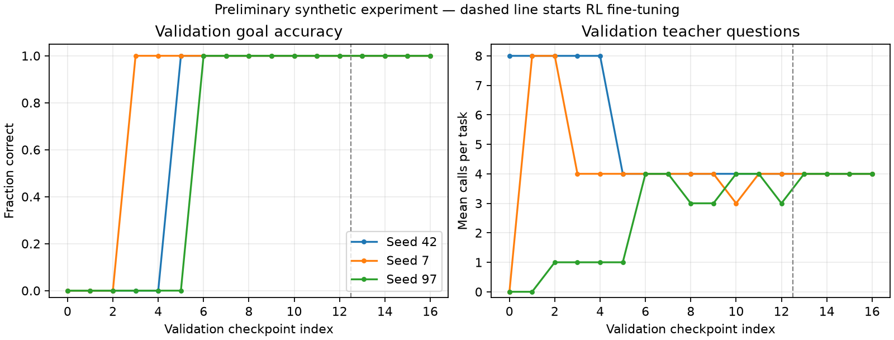

# Preliminary experiment results

This is an agentic-AI work in progress. These measurements describe narrow synthetic
experiments, not general intelligence, independent grammar learning, or a finished product.

The newer [delayed-question memory experiment](delayed-memory-v1/README.md) removes
the specific future-question hint and proof-first ordering. Its scoped gate passed;
mean learned accuracy was 22.61%, versus 4.44% FIFO and a 33.33% storage-only bound.
The original, easier experiments below remain unchanged for comparison.

## Question-selection replication

Source: `3666831e3571d0f52ed48b84abeb0d55f2bb1136`, clean working tree.
Configuration was frozen in `configs/confirmatory.json` before running three optimizer
seeds on a fresh generated test range, 500000–500199. All policies share the same
200 worlds; 600 evaluations are **not** 600 independent worlds.

| Policy | Correct / 200, seed 7 | Correct / 200, seed 42 | Correct / 200, seed 97 |
|---|---:|---:|---:|
| Learned | 200 | 200 | 200 |
| Untrained | 0 | 0 | 0 |
| Random | 0 | 0 | 1 |
| Fixed heuristic | 200 | 200 | 200 |
| Learned, no memory | 0 | 0 | 0 |

Learned mean teacher calls were 3, 4, and 3; heuristic mean calls were 4 for every
seed. This illustrates improvement over initialization and a small efficiency gain
over this particular heuristic in two seeds. It does not establish superiority over
strong information-gathering methods. Three optimizer seeds are preliminary.

Checkpoints were selected solely by validation reward, with ties favoring the earlier
checkpoint. Selected checkpoints came from imitation epochs 10, 5, and 8 respectively.
**No additional benefit of REINFORCE is established by this replication.**

The generator uses short monotonic inheritance proofs and engineered reachability
features. The inference procedure is supplied. Answer content comes from evidence;
the task family does not test free-form hallucination or calibrated uncertainty.
Each per-world 200/200 accuracy Wilson interval is approximately [0.981, 1.000]; this
interval is not an uncertainty interval over optimizer seeds or real-world tasks.

Full configurations, baselines, environment metadata, and validation curves are in
`replication-summary.json`, `seed-*-report.json`, and `seed-*-curve.csv`.

## Bounded memory reproduction

`memory-reproduction.json` repeats the memory experiment from the same clean source.
On 100 generated worlds (200000–200099), learned and fixed heuristic retention
preserved enough evidence to answer 100/100; FIFO and untrained retention answered
0/100. Accessible stores have 4 episodic and 3 belief slots.

This is a reproduction of a development benchmark, not a new untouched test set.
The future query is supplied as a hint, proof facts arrive before distractors, and
consolidation occurs after each observation. Only retention priorities are learned;
retrieval and consolidation timing are not learned.

## Integrated operation and language smoke

`joint-evaluation.json`: separately trained question and retention controllers
answered 200/200 fresh worlds (600000–600199), with 4 questions per task. This checks
integration, not joint training or resilience to delayed distractions in that benchmark.

`language-smoke.json`: actual frozen SmolLM2-135M weights supplied two 200-token pages
from one forward pass. A separate, untrained residual scorer selected eight output
tokens. Its default matches the language prior. A sentence-rendering proposal failed
the strict fidelity check and correctly used the template fallback. This establishes
interface operation, not a gain in fluency or learned token-selection performance.

Unit tests optimize token selection only on a small artificial distribution. The
public reports contain synthetic data and metrics; no conversations, credentials,
databases, model weights, or checkpoints are published.

## Reproduce

Use README setup, then `autonomous-learner replicate --config configs/confirmatory.json`.
For plots, install `.[plots]` and run `python scripts/plot_results.py`. Wall-clock timings
will differ across machines. Exact environment package versions are recorded in
`environment.txt`; this is a development snapshot, not a cross-platform lockfile.
