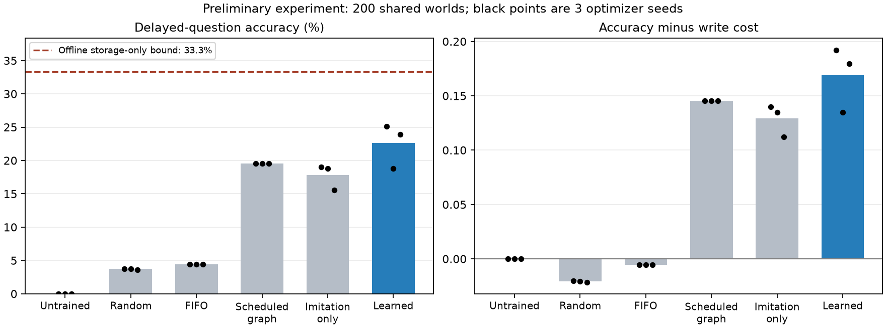

# Delayed-question memory — preliminary result

An experiment developed primarily by agentic AI, not a finished capability or evidence
of learned logic. Source: `d675f4b38749c16b7054644b1ca846beed90d946`, clean working tree.
Protocol and numerical configuration were frozen before final evaluation; see
[protocol](../../docs/experiments/delayed-goal-memory.md) and
[seed ledger](../../docs/experiments/SEED_RANGES.md).

## What changed

The future specific question is withheld until after a shuffled 15-fact stream and
two quiet ticks. The possible query vocabulary/distribution and horizon remain public.
At most 2 episodic facts and 6 belief facts are accessible, with 6 consolidation writes.
Episodic evidence expires before evaluation. The policy learns WAIT/CONSOLIDATE and
retention scores. The inference rule, feature engineering, and expert bootstrap are supplied.

## Frozen final evaluation

Optimizer seeds 7, 42, 97 share 200 held-out worlds, 2000000..2000199. Each world has
9 related possible questions; worlds, not individual questions or optimizer repeats,
are the resampling unit. Utility is accuracy minus 0.01 per consolidation operation.

| Policy | Seed 7 accuracy | Seed 42 accuracy | Seed 97 accuracy | Mean utility |
|---|---:|---:|---:|---:|
| Learned, validation-selected | 25.11% | 18.78% | 23.94% | 0.1689 |
| Imitation only, validation-selected | 19.06% | 18.78% | 15.56% | 0.1290 |
| Untrained (defaults to WAIT) | 0.00% | 0.00% | 0.00% | 0.0000 |
| Random | 3.78% | 3.78% | 3.61% | -0.0208 |
| Scheduled FIFO | 4.44% | 4.44% | 4.44% | -0.0056 |
| Dynamic graph heuristic | 4.06% | 4.06% | 4.06% | -0.0194 |
| Scheduled graph heuristic | 19.56% | 19.56% | 19.56% | 0.1456 |

The learned mean accuracy is **22.61%**. An offline, full-stream best-subset search
gives a **33.33% storage-only upper bound** at six belief facts; it ignores online
availability and is not an operational policy. Unlimited storage answers 100% and
no accessible evidence answers 0% under the supplied inference procedure.

All operational policies obeyed the same hard ceilings, with zero capacity violations.
Learned policies used 5.890, 5.280, and 5.985 writes on average; the scheduled heuristics
used 5. Different actual write counts are charged in utility, not hidden.

The predefined gate passed: every trained seed improved over initialization and the
paired utility advantage over FIFO excluded zero. Averaging optimizer seeds within
each world, the 95% world-bootstrap intervals for learned minus baseline utility are:

- FIFO: +0.1745, interval [0.1609, 0.1868].
- Scheduled graph: +0.0234, interval [0.0067, 0.0391].
- Imitation only: +0.0399, interval [0.0314, 0.0486].

Only FIFO was the primary success comparison. Other intervals are unadjusted exploratory
comparisons. They do not measure uncertainty over optimizer seeds or new task families.
One trained seed underperformed the scheduled graph heuristic. The selected models
for seeds 7/97 came from RL iterations 40/240; seed 42 retained imitation epoch 11.
The imitation ablation supports an RL contribution in this setting, not a universal benefit.



## Failed validation attempt and debugging

The first bootstrap teacher was the dynamic graph heuristic. It spent writes too early;
all three seeds selected the initial idle policy with zero validation utility. This
failed the gate. The negative result was reproduced from the same clean source using
`bootstrap_policy: "graph"`; see `validation-frontloaded.json`.

The scheduled graph baseline performed better on validation. It became the bootstrap
teacher before opening final tests; training/resource hyperparameters were unchanged.
`validation-scheduled.json` records the revised validation run. The reserved final
range was also moved before use to avoid an existing interactive-demo seed.

## Remaining limitations

- Shared fixed graph family, known public vocabulary/query distribution/horizon, and
  only three optimizer seeds. Generalization to changing budgets/horizons is untested.
- Memory control is learned from a supplied graph expert plus RL. It does not discover
  inference rules. Structural features include locally computable proof coverage.
- The selector fills available belief slots; admission count, retrieval, source
  reliability, contradictions, and belief revision are not learned here.
- Correctness conditional on answering is 100% by construction for this reliable
  oracle and supplied inference. It is not a calibrated uncertainty result.
- This passes a scoped M2 experiment, not every item in the memory-management milestone.

## Reproduce and inspect

Install the optional `.[plots]` dependencies before running the plotting script.

```powershell
.\.venv\Scripts\python.exe -m autonomous_learner delayed-memory --config configs/delayed-memory.json --output runs/delayed-repeat --phase final
.\.venv\Scripts\python.exe scripts/plot_delayed_memory.py
```

Treat the final range as already opened after this report. Do not tune on it. Use
`--phase validation` during development and reserve a new range for a new confirmatory
experiment. `final.json` contains source/config/curves/selection/aggregate results;
`world-metrics.csv` contains only synthetic per-world metrics. No checkpoints, agent
snapshots, private conversations, or audit logs are published.
